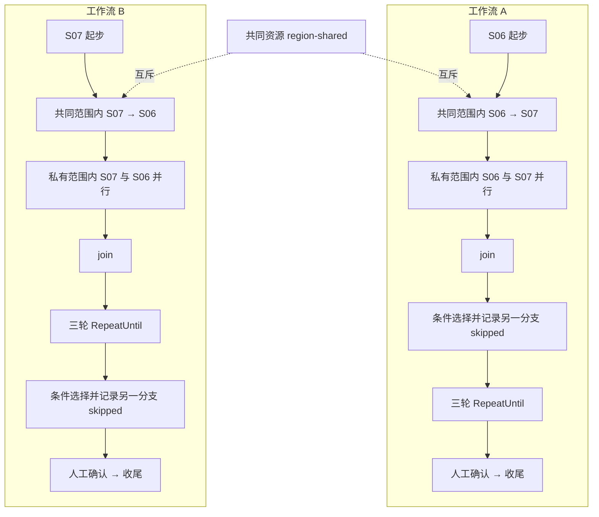

# 两个综合工作流的并行调度验收

本次按 **24 个场景族**组织调度能力，详见 [场景覆盖矩阵](SCENARIOS.csv)。这是本项目的验收分类，不表示调度只有24种可能情况。分支、资源绑定、回执顺序和故障位置的组合不能靠一次成功运行穷尽。

**实测结果：11种配置全部通过，22个任务、269次模拟工艺命令。19个任务成功，另外3个按预期失败/超时/取消；活动 Claim 和 Lease 均为0。** [汇总数据](SUMMARY.json)。

## 两个不同的工作流

- [工作流 A 冻结定义](workflow-A.json)：先条件判断，再三轮循环。
- [工作流 B 冻结定义](workflow-B.json)：先三轮循环，再条件判断；默认优先级更高，起始设备与 A 相反。



每个定义有15个模板节点，其中循环体动态创建3个不同 Job；正常完整执行每个工作流产生14次工艺命令。共同范围跨 hold1/hold2 持有；hold1 的设备范围嵌套其中，hold2 换到另一设备。fork 的两个分支拥有共同私有外层范围，在设备可用时并行，join 必须等待两者完成。

JSON 是本次运行的完整冻结计划及绑定快照，使用配套运行器复现；**不是网页导入格式，没有上传到业务工作流列表**。运行器会为每个配置重新创建两份独立任务和库存绑定。

## 为什么需要多次运行

正常完成、失败、超时和取消是互斥结局；容量1和容量2也是不同配置。使用同一对工作流多次运行，能够验证这些变化如何影响整个组合，而不是把失败节点拼在成功路径里后声称都测试过。

运行配置如下：

| 配置 | 施加的变化 | 预期 |
|---|---|---|
| normal | A/B 正常提交，各自选择不同条件分支 | 两者成功，最大在途2 |
| reverse | B 先提交，并交换两者条件输入 | 两者成功，覆盖另一分支 |
| capacity | 最大在途设为1 | 两者成功且不超限 |
| controls | 两任务暂停，同时开启 drain；先完成在途，再依次恢复 | 暂停和排空期间无后继派发，恢复后成功 |
| step | 两任务使用单步模式 | 逐节点放行，循环、条件及人工节点正确推进 |
| uncertain | 两任务首命令完成后先注入未知结果 | Claim 保持 uncertain，明确回执后成功，无重复物理派发 |
| failed | A 首命令完成后注入失败回执 | A failed，B succeeded |
| timeout | A 首命令完成后注入超时回执 | A timeout，B succeeded |
| cancel | A 在途时请求取消，等待其原命令完成 | A canceled，B succeeded |
| inventory | 两任务各需2mL，先缺料阻塞，再补入4mL | 原任务/Job继续执行；总量、可用量、预留量最终都为0 |
| priority | 先 drain 同时积累候选，再以容量1放行 | 高优先级 B 先取得槽位，两者最终成功 |

每个正常回执重复投递两次；每个人工批准也重复两次。运行器独立检查物理派发 Job 身份不重复、同通道命令不重叠、范围所有者不冲突、join 不提前、循环恰为三轮、分支 skipped 及任务终态，结束后检查活动 Claim 和软件 Lease 均为0。

## 证据与实际边界

- [首批9配置的 PLC 结果](plc-01/result.json)：213次模拟工艺命令，9项配置通过。
- [补料和优先级配置结果](plc-extra-01/result.json)：56次命令，两项通过。
- [专项回归日志](regression.log)：118 passed，2个依赖弃用警告。
- [专项回归 JUnit](regression.xml)：完整调度核心套件及 `test_runtime_restart_cleanup.py`。
- `plc-01/` 与 `plc-extra-01/` 保存各配置冻结定义、事件时间线及双 SQLite 数据库。
- [运行器](../../../scripts/validation/scheduler_composite.py)。`core-*` 是无 PLC 的测试构造/核心验证记录，不能混为 PLC 实测。早期构造错误和中断记录保留，不计入通过数。

两个工作流组合了可兼容的正常行为和可切换的运行控制。整组申请失败、陈旧 Fence、aging、并发回调、命名 Site/物理搬运、故意死锁、进程重启等仍有专用前置条件，具体边界在24行矩阵中逐项标出；**没有把这些专项全部塞进这两个工作流，也不声称全部组合都已穷尽**。

实测链路为：冻结计划 → TaskSchedulerBridge / EdgeScheduler → 真实持久化库存 → CallbackDispatcher → OPC UA PLC Sim。软件范围身份用独立库存设备类资源承载。没有经过产品 HTTP API、网页或实际 simple/ROS 驱动，没有做生产进程崩溃、物理搬运或72小时长稳。

PLC 命令窗口的重叠通过两通道的参数写入位、工艺选择和未完成位观测；不等同于真实机械运动传感器。循环 qualified 是测试运行器在每个真实模拟命令完成后按次数生成的结果。库存4mL是虚拟账本，未驱动物理液体。失败/超时/未知配置是在真实命令完成后注入软件回执，取消配置让原命令自然完成；这些不能冒充真实PLC故障或急停验收。本次未启用 SigNoz 导出。

## 复跑

确保 S06/S07 模拟工站空闲且无其他运行器控制。从仓库根目录，在独立终端建立端口转发：

```bash
kubectl -n edge port-forward svc/plc-sim 24855:4855
```

执行全部11个配置；输出目录必须尚不存在：

```bash
/Users/xiongyanfei/.local/share/mamba/envs/unilab/bin/python \
  -m scripts.validation.scheduler_composite \
  --endpoint opc.tcp://127.0.0.1:24855/xuse_sim/ \
  --output docs/validation/scheduler-composite/plc-rerun \
  > /tmp/composite-rerun.log 2>&1
```

省略 endpoint 为明确标注的核心替身验证。可用 `--profiles normal,reverse` 选择子集。重复回执会产生“unknown job finished”警告，这是本次刻意重投后的观测，不能仅以日志出现 warning 判失败；按预期状态和不变量判定。
